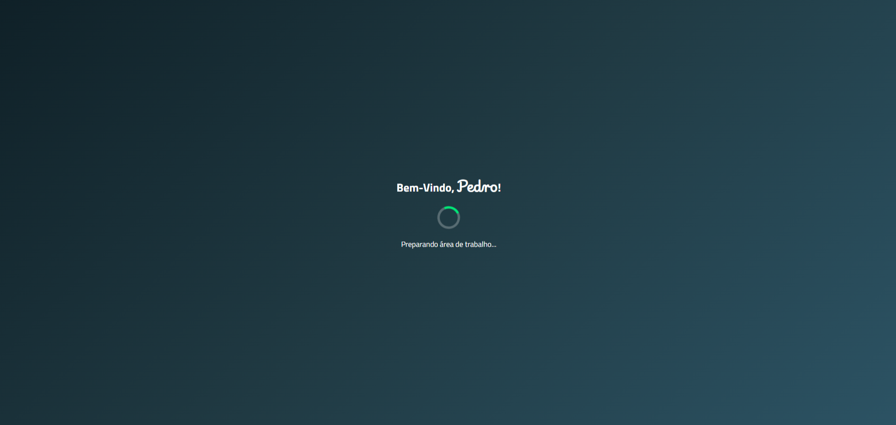

# Children's Desktop

**Language:** [🇧🇷 Português](README.md) | [🇺🇸 English](README.en.md)

  <strong>A computer-learning environment inspired by the Windows desktop.</strong>

  
  
  
  
  

## About the project

**Children's Desktop** is an educational project created to practice HTML5, CSS3, and JavaScript. Its purpose is to build an environment inspired by the Windows desktop, adapted for children who are beginning to learn how to use a computer.

The idea came from the author's experience as a basic computer teacher for children from 1st to 5th grade. The goal is to provide a simple, familiar, and safe interface where children can explore digital tools without accidentally deleting, creating, or renaming important files.

The project also aims to encourage parents and guardians to take part in the learning process, especially when children use the family computer.

## Romárinho

Romárinho is the child character that accompanies the project. His name refers to **ROM**, ROM memory, and the world of video games, combined with the Brazilian and childlike suffix **rinho**.

## Screenshots

  

  

  

## Current features

- Login screen that identifies the child by name.
- Name stored only during the browser session.
- Windows-inspired loading screen.
- Children's desktop interface.
- Taskbar with clock and date.
- Start menu.
- Sign out or switch user option.
- **My Files** window.
- Calculator with math operations.
- Initial Notepad structure.
- Window controls such as minimize, close, maximize, and drag, according to each application.

> The project does not use a database. When the session ends, the entered name is not saved permanently.

## Technologies and tools

- HTML5
- CSS3
- JavaScript
- Git and GitHub
- Courses by Professor Gustavo Guanabara
- Claude Code and Codex as development support tools

## Next steps

- Develop the text editor with a template based on ABNT standards.
- Create a painting window for younger students.
- Allow wallpaper selection.
- Create a folder to store completed drawings.
- Develop games and quizzes about computing subjects.
- Expand the **My Computer** and **My Files** areas.
- Allow users to create new folders.
- Implement copy-and-paste features on the desktop.

## How to run

1. Download or clone this repository.
2. Open the project folder.
3. Open `index.html` in a browser.

## Author

Project developed by IamPedroDias, based on his experience as a basic computer teacher for children.
