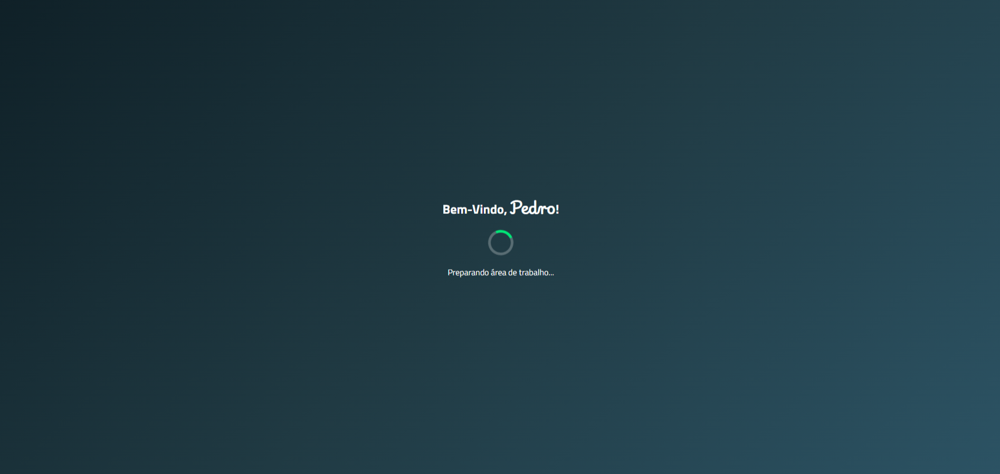

# Desktop Infantil

**Idioma:** [🇧🇷 Português](README.md) | [🇺🇸 English](README.en.md)

<p align="center">
  <strong>Um ambiente de aprendizagem de informática inspirado na área de trabalho do Windows.</strong>
</p>

<p align="center">
  
  
  
  
  
</p>

## Sobre o projeto

O **Desktop Infantil** é um projeto educacional desenvolvido para praticar **HTML5, CSS3 e JavaScript**. A proposta é criar um ambiente inspirado na área de trabalho do Windows, adaptado para crianças que estão começando a aprender a usar o computador.

A ideia surgiu da experiência do autor como professor de informática básica para crianças do 1º ao 5º ano. O objetivo é oferecer uma interface simples, familiar e segura, onde a criança possa explorar ferramentas digitais sem o risco de apagar, criar ou renomear arquivos importantes por engano.

O projeto também procura incentivar a participação de pais e responsáveis no aprendizado, especialmente em situações em que a criança utiliza o computador da família.

## Romárinho

Romárinho é o personagem infantil que acompanha o projeto. Seu nome faz referência a **ROM**, memória ROM e ao universo dos jogos, combinado ao sufixo brasileiro e infantil **rinho**.

## Capturas de tela

<p align="center">
  
</p>

<p align="center">
  
</p>

<p align="center">
  
</p>

## Recursos atuais

- Tela de login com identificação pelo nome da criança.
- Nome armazenado somente durante a sessão do navegador.
- Tela de carregamento inspirada no Windows.
- Área de trabalho infantil.
- Barra de tarefas com relógio e data.
- Menu Iniciar.
- Opção para sair ou trocar de usuário.
- Janela **Meus Arquivos**.
- Calculadora com operações matemáticas.
- Estrutura inicial do Bloco de Notas.
- Controles de janela, como minimizar, fechar, maximizar e arrastar, de acordo com cada aplicativo.

> O projeto não utiliza banco de dados. Ao encerrar a sessão, o nome informado não é salvo permanentemente.

## Tecnologias e ferramentas

- HTML5
- CSS3
- JavaScript
- Git e GitHub
- Cursos do professor Gustavo Guanabara
- Claude Code e Codex como ferramentas de apoio ao desenvolvimento

## Próximos passos

- Desenvolver o editor de texto com modelo baseado nas normas da ABNT.
- Criar uma janela de pintura para os alunos mais novos.
- Permitir a escolha de papel de parede.
- Criar uma pasta para guardar os desenhos produzidos.
- Desenvolver jogos e quizzes sobre assuntos de informática.
- Ampliar as áreas **Meu Computador** e **Meus Arquivos**.
- Permitir a criação de novas pastas.
- Implementar recursos de copiar e colar arquivos na área de trabalho.

## Como executar

### Pré-requisitos
- [Node.js](https://nodejs.org/) instalado no computador.

### Passo a passo
1. Baixe ou clone este repositório.
2. Abra o terminal na pasta do projeto e instale as dependências:
   ```bash
   npm install
   ```
3. incie o servidor de desenvolvimento:
	```bash
	npm run dev
	```
4. Abra no navegador o endereço local exibido (geralmente `http://localhost:5173`).

## Autor

Projeto desenvolvido por IamPedroDias, a partir de sua experiência como professor de informática básica para crianças.
